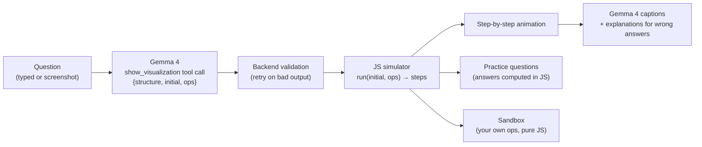

# CodeVisualz

> **zyBooks animates its own examples, not the questions you actually have to solve. We animate any question, typed or screenshotted, and let you play with it.**

Paste or screenshot a data-structures question (or just ask "how does a stack work?") and get a step-by-step animation with captions, practice questions, and a sandbox to try your own operations.

## Demo

- 🎥 **Video:** _[link coming soon]_

| Typed question → animation | Screenshot → "Here's what I read" → animation |
|---|---|
| _[screenshot 1]_ | _[screenshot 2]_ |

## How it works



**The one rule: Gemma understands, JavaScript computes.**
Gemma 4 reads the question and decides *what* to show: which structure, its starting contents, and the exact operations. Every step, every state, and every correct answer is computed by plain JavaScript, so **the animation is never wrong**. Gemma also writes captions and explains wrong answers, but only by restating facts the JS simulator produced.

## Why Gemma 4

| Feature | How we use it |
|---|---|
| **Image input** | Screenshot a zyBooks or homework question; Gemma reads the values and operations straight from the image. |
| **Function calling** | Gemma must answer with a strict, fully typed `show_visualization(structure, initial, ops, source)` tool call, never free text. |
| **Thinking mode** | High thinking for reading the question; minimal thinking for fast captions. |
| **Open weights** | Gemma 4 is an open model; we use `gemma-4-31b-it` with a `gemma-4-26b-a4b-it` fallback through the Gemini API. |

## Reliability

We didn't just trust the model. Our eval ([eval/eval_plan.py](eval/eval_plan.py)) sends real CSE 12 zyBooks questions to Gemma and checks every field. It caught real errors:

- **Reordered inserts:** 26b turned "Insert 50, 30, 70, 20, 40" into 50, 30, 40, 20, 70, which builds a different BST.
- **Junk args:** `peek` with args `["peek"]`, `dequeue` with `["[],"]`.
- **Overload:** 31b returned 503/500 "high demand" on most calls during the hackathon.

So the backend validates **every** plan before the browser sees it and retries once with a note saying what was wrong:

- op names valid for the structure, and the right number of args per op
- no empty args; a valid table size for hash tables
- **number faithfulness:** no number appears more often than it does in the question
- **order:** the numbers in the ops appear in the same order as in the question

It falls back to 26b when 31b is overloaded, and the demo questions have cached responses.

**Eval results:** _[first-try X/6, after retry Y/6, placeholder]_

## Supported structures

| Structure | Status |
|---|---|
| Stack | ✅ |
| Doubly linked list | ✅ |
| Binary search tree | _[placeholder: in progress]_ |
| Singly linked list, queue, hash tables (linear probing, chaining) | _[placeholder: if they ship]_ |
| Heap, insertion sort | _[placeholder: stretch]_ |

## Run locally

Requires [uv](https://docs.astral.sh/uv/) and a Gemini API key.

```bash
uv sync
export GEMINI_API_KEY=...          # PowerShell: $env:GEMINI_API_KEY="..."
uv run uvicorn backend.main:app --port 8000
# open http://localhost:8000
```

> **`CERTIFICATE_VERIFY_FAILED` (e.g. Avast HTTPS scanning)?** Python and uv don't trust the antivirus's certificate by default. Set `UV_NATIVE_TLS=1` for `uv sync`, and make sure `import truststore; truststore.inject_into_ssl()` runs before `google.genai` is imported (`truststore` is already a dependency).

## Tests

```bash
node eval/test_viz.mjs              # JS visualizations match samples/ and the module contract (no API key)
uv run pytest                       # backend unit tests (no API key)
uv run python eval/eval_plan.py     # live eval of Gemma's plans (needs GEMINI_API_KEY; ~15 req/min free tier)
```

## Project layout

```
backend/    FastAPI app, Gemma calls, prompts, plan validation
frontend/   index.html + app; viz/<structure>.js = run / render / questions per structure
samples/    example plans + steps (also used as cached demo responses)
eval/       Gemma plan eval + JS visualization tests
docs/       requirements and demo script
```

See [CLAUDE.md](CLAUDE.md) for the full contracts (tool call, step format, viz module interface, endpoints).

## Team

Built at **DS3 Hacktoberfest Hack Day 2026 (UCSD)** by:

- _[name 1]_
- _[name 2]_
- _[name 3]_
- _[name 4]_

## License

[MIT](LICENSE)
