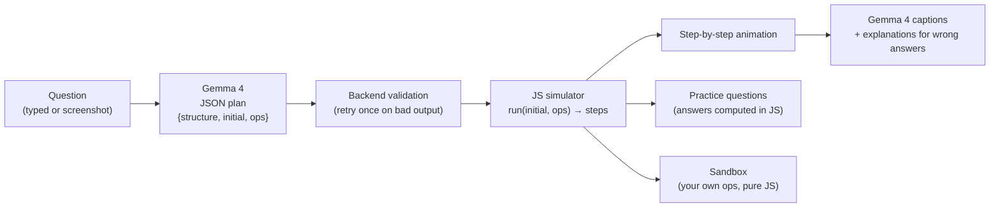

# CodeVisualz

> **zyBooks animates its own examples, not the questions you actually have to solve. We animate any question, typed or screenshotted, and let you play with it.**

Paste or screenshot a data-structures question (or just ask "how does a stack work?") and get a step-by-step animation with captions, practice questions, and a sandbox to try your own operations.

## Demo

- 🎥 **Video:** _[link coming soon]_

| Typed question → animation | "Here's what I read" → animation |
|---|---|
| _[screenshot 1]_ | _[screenshot 2]_ |

## How it works



**The one rule: Gemma understands, JavaScript computes.**
Gemma 4 reads the question and decides *what* to show: which structure, its starting contents, and the exact operations, as a small JSON plan. Every step, every state, and every correct answer is computed by plain JavaScript, so **the animation is never wrong**. Gemma also writes captions and explains wrong answers, but only by restating facts the JS simulator produced.

## Why Gemma 4

| Feature | How we use it |
|---|---|
| **Structured output** | Gemma replies with one JSON object, `{structure, initial, ops, source}`, that the backend checks against our schema. We started with function calling, but our tests showed the 26B model returning empty or garbled plans in tool mode, while plain JSON replies got the values right. |
| **Image input** | Screenshot a zyBooks or homework question; Gemma 4 reads the values and operations straight from the image. |
| **Speed vs. thinking** | We measured thinking levels and use `minimal`: typed questions come back in about 2 seconds, which keeps the app interactive. |
| **Open weights** | Gemma 4 is an open model; we use `gemma-4-26b-a4b-it` for typed questions, screenshots, captions, and explanations, through the Gemini API. |

## Reliability

We didn't just trust the model. Our eval ([eval/eval_plan.py](eval/eval_plan.py)) sends real CSE 12 zyBooks questions and messy student-style questions to Gemma and checks every field. It caught real errors:

- **Reordered inserts:** 26B turned "Insert 50, 30, 70, 20, 40" into 50, 30, 40, 20, 70, which builds a different BST.
- **Swapped arguments:** `insert_after ["45", "12"]` (insert 12 after 45) instead of `["12", "45"]`.
- **Empty or junk plans:** no operations at all, `peek` with args `["peek"]`, `dequeue` with `["[],"]`.
- **Overload:** 31B returned 500/503 "high demand" on most calls during the hackathon.

So the backend validates **every** plan before the browser sees it, and retries once with a note saying what was wrong:

- op names valid for the structure, and the right number of args per op
- every value is one plain number or word; a valid table size for hash tables
- **no empty plans:** a specific question must have starting contents or operations
- **linked lists:** `insert_after` must name a node that's in the list at that point
- **number faithfulness:** no number appears more often than it does in the typed question
- **order:** the operations' values appear in the same order as in the typed question

The three demo questions also have cached plans, so they load instantly even if Gemma is busy.

**Latest results (2026-10-25):** 55/55 visualization tests, 35/35 backend tests, and the typed demo stack question was correct 3/3 times in about 2 seconds each. Screenshot of the zyBooks linked-list question: 3/3 correct in 3–4s (it was 0/7 when we used tool calling; switching to plain JSON plans fixed it).

## Supported structures

| Structure | Operations |
|---|---|
| Stack | push, pop, peek |
| Queue | enqueue, dequeue, peek |
| Singly linked list | append, prepend, insert_after, remove, search |
| Doubly linked list | append, prepend, insert_after, remove, search |
| Binary search tree | insert, search, remove (including the in-order successor case) |
| Hash table, linear probing | insert, search, remove (with tombstones) |
| Hash table, chaining | insert, search, remove |

## Run locally

Requires [uv](https://docs.astral.sh/uv/) and a Gemini API key.

```bash
uv sync
export GEMINI_API_KEY=...          # PowerShell: $env:GEMINI_API_KEY="..."
uv run uvicorn backend.main:app --port 8000
# open http://localhost:8000
```

> **`CERTIFICATE_VERIFY_FAILED` (e.g. Avast HTTPS scanning)?** uv doesn't trust the antivirus's certificate by default, so set `UV_NATIVE_TLS=1` for `uv sync`. The backend itself already loads `truststore` (in `backend/gemma.py`) before talking to the Gemini API.

## Tests

```bash
node eval/test_viz.mjs              # JS visualizations match samples/ and the module contract (no API key)
uv run pytest                       # backend unit tests (no API key)
uv run python eval/eval_plan.py     # live eval of Gemma's plans (needs GEMINI_API_KEY; ~15 req/min free tier)
```

## Project layout

```
backend/    FastAPI app, Gemma calls, prompts, plan validation, demo-question cache
frontend/   index.html + app; viz/<structure>.js = run / render / questions per structure
samples/    example plans + steps for each structure
eval/       Gemma plan eval + JS visualization tests
docs/       requirements, demo script, demo screenshot
```

See [CLAUDE.md](CLAUDE.md) for the full contracts (plan format, step format, viz module interface, endpoints).

## Team

Built at **DS3 Hacktoberfest Hack Day 2026 (UCSD)** by:

- _[name 1]_
- _[name 2]_
- _[name 3]_
- _[name 4]_

## License

[MIT](LICENSE)
